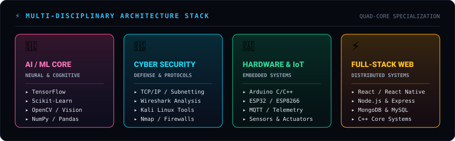
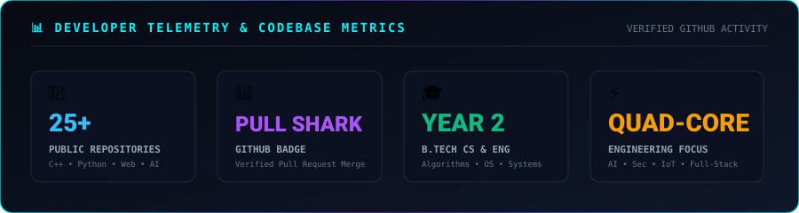

<!-- ═══════════════════════════════════════════════════════════════════════ -->
<!--                       1. ULTRA-TECH HERO BANNER                        -->
<!-- ═══════════════════════════════════════════════════════════════════════ -->

 

<!-- ═══════════════════════════════════════════════════════════════════════ -->
<!--                       2. DYNAMIC REAL-TIME TYPING                      -->
<!-- ═══════════════════════════════════════════════════════════════════════ -->

 

<!-- ═══════════════════════════════════════════════════════════════════════ -->
<!--                       3. TELEMETRY COUNTERS & BADGES                   -->
<!-- ═══════════════════════════════════════════════════════════════════════ -->

  
  &nbsp;
  
  &nbsp;
  
  &nbsp;
  

---

<!-- ═══════════════════════════════════════════════════════════════════════ -->
<!--                       4. SENIOR DEVELOPER TERMINAL GUI                 -->
<!-- ═══════════════════════════════════════════════════════════════════════ -->

  

---

<!-- ═══════════════════════════════════════════════════════════════════════ -->
<!--                       5. INTERACTIVE CONNECT HUB                       -->
<!-- ═══════════════════════════════════════════════════════════════════════ -->

## 🌐 Quick Connect & Professional Hub

  
  &nbsp;
  
  &nbsp;
  
  &nbsp;
  

  
  &nbsp;
  
  &nbsp;
  
  &nbsp;
  

  
  &nbsp;
  

---

<!-- ═══════════════════════════════════════════════════════════════════════ -->
<!--                       6. MULTI-DISCIPLINARY ARCHITECTURE               -->
<!-- ═══════════════════════════════════════════════════════════════════════ -->

  

---

<!-- ═══════════════════════════════════════════════════════════════════════ -->
<!--                       7. INTERACTIVE TECH PALETTE (GUI LAUNCHER)       -->
<!-- ═══════════════════════════════════════════════════════════════════════ -->

## 🧰 Integrated Toolchain & Technologies

  

### 🧠 1. Artificial Intelligence, Data Science & Machine Learning

  
  
  
  
  
  
  

### 🔐 2. Networking, Cyber Security & Infrastructure

  
  
  
  
  
  

### 🔌 3. IoT, Embedded Systems & Hardware Automation

  
  
  
  
  

### 💻 4. Core Languages, Frameworks & Database Systems

  
  
  
  
  
  
  
  
  

---

<!-- ═══════════════════════════════════════════════════════════════════════ -->
<!--                       8. REAL-TIME GITHUB ANALYTICS                    -->
<!-- ═══════════════════════════════════════════════════════════════════════ -->

## 📊 Live Telemetry & GitHub Performance

  

---

<!-- ═══════════════════════════════════════════════════════════════════════ -->
<!--                       9. ACTIVITY GRAPH                                -->
<!-- ═══════════════════════════════════════════════════════════════════════ -->

## 📈 Activity & Contribution Velocity

---

<!-- ═══════════════════════════════════════════════════════════════════════ -->
<!--                       10. FEATURED CODEBASES TABLE                     -->
<!-- ═══════════════════════════════════════════════════════════════════════ -->

## 💼 Featured Engineering Codebases

| 🚀 Codebase | 🛠️ Tech Stack | 📌 System Purpose | 🔗 Repository |
|:---|:---:|:---|:---:|
| **Coursera Assignments Portfolio** | `HTML5` `CSS3` `JavaScript` | Front-end web development assignments & responsive client layouts | [**View Repository →**](https://github.com/abdulwarisgurkhoo/coursera_assignment.github.io) |
| **Sorting Algorithm Suite** | `C++` `DSA` `Algorithms` | Benchmark implementations of linear and recursive sorting algorithms | [**View Repository →**](https://github.com/abdulwarisgurkhoo/sorting_algorithm) |
| **Array Sorting Questions** | `C++` `Data Structures` | Problem-solving repository dedicated to linear data structure arrays | [**View Repository →**](https://github.com/abdulwarisgurkhoo/array_sorting_questions) |
| **Recursive Natural Calculations** | `C++` `Recursion` | Core recursion implementations for natural numbers & recursive sequences | [**View Repository →**](https://github.com/abdulwarisgurkhoo/to_fine_sum_of_n_natural_numbers_using_recursion) |

---

<!-- ═══════════════════════════════════════════════════════════════════════ -->
<!--                       11. FOOTER BANNER & CTA                          -->
<!-- ═══════════════════════════════════════════════════════════════════════ -->

  

  
  &nbsp;&nbsp;
  
  &nbsp;&nbsp;
  

 

**⭐ If you like what you see, feel free to star my repositories — it fuels continuous innovation! ⭐**

